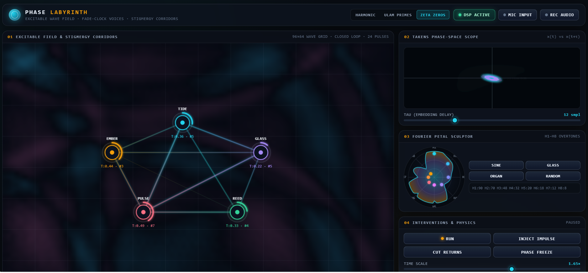

# PHASE LABYRINTH



Try it now

[Try it!](https://anttiluode.github.io/PhaseLabyrinth/)

**PHASE LABYRINTH** is a browser-based, zero-dependency audiovisual instrument and dynamical systems synthesizer built in a single `index.html` file. 

Instead of sequencing notes on a rigid BPM grid, five autonomous voices live inside an excitable 2D wave medium. Each voice is silenced by incoming activity and **fires into silence** when its local trace fades below threshold—launching physical wave ripples, carving self-reinforcing stigmergy corridors between nodes, and feeding a stereo Web Audio delay labyrinth.

**Live Demo:** [https://anttiluode.github.io/PhaseLabyrinth/](https://anttiluode.github.io/PhaseLabyrinth/)

---

## Genealogical Lineage & Fused Mechanisms

This instrument combines mechanisms isolated across several repositories in the [Genealogy](https://github.com/anttiluode/genealogy) research archive[cite: 1]:

* **Fade-Triggered Winnerless Competition (`GeometricNeuronV30` / `FireIntoSilence`)** — Nodes do not fire on a master clock. Incoming waves suppress their local trace; whichever voice fades below threshold first fires into the quiet gap, resetting neighboring traces and weaving self-organizing polyrhythms.
* **Stigmergic Desire-Paths (`BlackBoxLab` / `WorldAsResonator`)** — Repeated wave transmissions between active nodes compact the underlying medium, carving glowing conductive corridors that lower local damping and bias future signal routing.
* **Cross-Coupled Delay Corridors (`MusicalDelayLabyrinth`)** — Node positions map directly to stereo pan and delay-line lengths, running through damped feedback loops with a `tanh` soft-limiter so rhythms sustain and evolve even after external impulses stop.
* **Spectral & Prime-Spiral Tunings (`UlamInterlace` / `hilbert-polya-delay-network`)** — Switch pitch relationships and delay tap ratios on the fly between **Harmonic**, **Ulam Primes**, and non-harmonic **Zeta Zeros** for metallic, glass-like ambient drones[cite: 1].
* **Interactive Harmonic Petal Sculptor (`fourier-flower` / `AdelicPhaseFreezerVST`)** — Real-time additive `PeriodicWave` synthesis shaped by dragging 8 radial harmonic petals, paired with an **Adelic Phase Freeze** latch that locks the delay corridors into an infinite resonant sustain[cite: 1].
* **Live Delay-Coordinate Oscilloscope (`TakensPhaseSpaceVisualizerVST`)** — Renders the master stereo output as a real-time 2D Takens delay-embedding attractor $(x[t], x[t + \tau])$ with adjustable delay lag $\tau$.

---

## Controls & Interventions

### 1. Shared Excitable Field (Canvas)
* **Click / Drag Nodes:** Reposition any of the 5 voices (`EMBER`, `TIDE`, `GLASS`, `REED`, `PULSE`) in the field to change their stereo pan, delay corridor lengths, and wave propagation distances.
* **Click Empty Space:** Inject a manual wave impulse into the medium.
* **Presets:**
  * `WOVEN SILENCE` — Balanced polyrhythmic turn-taking across harmonic intervals.
  * `ZETA CATHEDRAL` — High-feedback spectral spacings with deep corridor compaction.
  * `PRIME PULSE` — Tighter, percussive Ulam-prime delay ratios.

### 2. Causal Interventions & Audio I/O
* **POWER AUDIO / PAUSE:** Initializes the Web Audio API synthesizer and starts/pauses the coupled wave simulation.
* **+ IMPULSE:** Drops a randomized wave disturbance into the field.
* **CUT RETURNS:** Causal ablation switch that severs feedback from the wave field and delay returns—letting you compare closed-loop self-organization directly against open-loop decay.
* **PHASE FREEZE:** Freezes delay corridor decay and locks the current harmonic state into a continuous drone.
* **MIC INPUT:** Routes live microphone onset transients directly into the wave field as physical impulses.
* **REC AUDIO:** Captures the live master output directly to a downloadable `.webm` audio file.

### 3. Inspector, Fourier Flower & Takens Scope
* **Per-Node Sliders:** Adjust individual **Fade Memory** (how long a node waits in silence before firing), **Return Strength** (how strongly its output feeds back into the wave medium), and **Pitch Ratio**.
* **Fourier Petal Sculptor:** Drag the 8 radial petals to sculpt overtone amplitudes in real time.
* **Takens Phase Scope:** Adjust `TAU` to inspect the geometric attractor of the live audio stream.

---

## Running Locally

No build tools, servers, or packages are required:

1. Clone the repository:
   ```bash
   git clone [https://github.com/anttiluode/PhaseLabyrinth.git](https://github.com/anttiluode/PhaseLabyrinth.git)
   cd PhaseLabyrinth
   ```
Open index.html directly in any modern desktop browser (Chrome, Edge, Firefox, or Brave) and click POWER AUDIO.

Or run it at its github.io straight. [Open!](https://anttiluode.github.io/PhaseLabyrinth/)

License
MIT License — see LICENSE for details.
   
